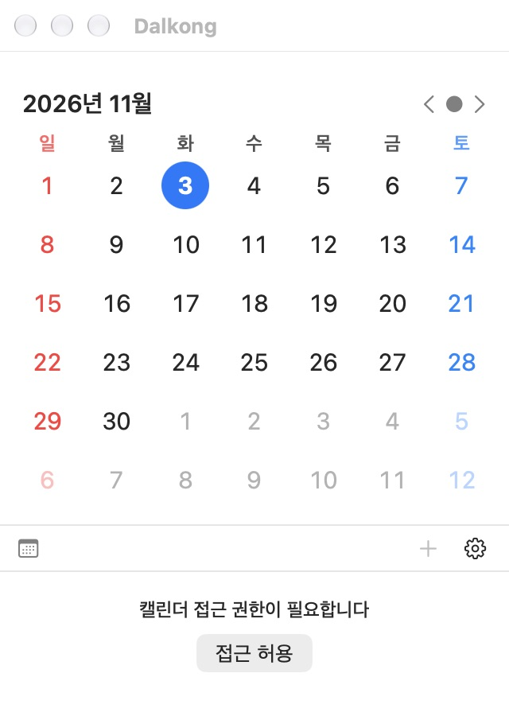

# Dalkong

macOS 메뉴 막대에서 달력과 일정을 빠르게 확인하고 관리하는 캘린더 앱입니다.



## 기능

- 메뉴 막대 팝오버에서 월간 달력 및 선택한 날짜의 일정 조회
- 새 일정 추가 (캘린더 선택, 시작·종료 시간, 반복, 알림 설정)
- 표시할 캘린더 선택, 주 시작 요일, 주차 표시, 메뉴 막대 날짜 표시 형식 설정
- 로그인 시 자동 실행 및 데스크톱 월간 달력 위젯(`WidgetKit`) 지원

## 실행 방법

```sh
git clone https://github.com/INT31302/Dalkong.git
cd Dalkong
open Dalkong.xcodeproj
```

1. Xcode에서 **Dalkong** 스킴과 **My Mac**을 선택해 빌드·실행합니다.
2. 첫 실행 시 시스템 캘린더(`EventKit`) 접근 권한을 허용하면 기존 캘린더 일정이 연동됩니다.

## 구조

- `Dalkong/` — 메뉴 막대 컨트롤러, 달력/일정 뷰, `EventKit` 스토어
- `MonthWidget/` — macOS 월간 달력 위젯 확장
